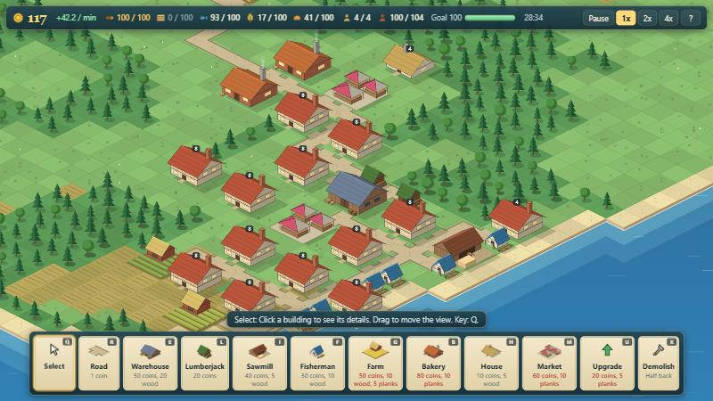

# Harborfall

A small Anno-style city builder that runs in a desktop browser. Settle one island, build a chain from wood to bread, and grow the town to 100 Workers. A game takes about 30 minutes, and you can play on to a city of 100 Artisans.



## Play it

1. Install [Node](https://nodejs.org) if you do not have it. The game was built and tested with version 24.
2. Double-click `start-game.bat` (Windows) or `start-game.command` (Mac). Or run `node serve.mjs --open` in this folder.
3. The game opens at `http://localhost:5173` on its title screen. It saves itself in the browser as you play. Press **?** in the game for the controls. Add `?demo` to the address to see a finished town.

## What is in here

- **Plain JavaScript and Canvas.** No framework, no build step, nothing to install besides Node, and no image or sound files. The art is drawn by code and the sounds are made by code.
- **Three separate layers.** The simulation (`src/sim/`) holds every rule and has no screen or browser code. The renderer (`src/render/`) draws it. The UI (`src/ui/`) turns clicks into commands.
- **All rules in data.** Every cost, speed and tax is in five JSON files in `data/`. Change a number, refresh, and the game changes.
- **Tested without a browser.** 600 automated tests, and a bot that plays whole games to check the balance.

## Check it

```bash
node --test
```

```bash
node tools/bot.mjs
```

The first runs every test. The second has a bot play a full game and print a report. It should win in about 28.9 minutes.

## Documents

| File | What it is |
|---|---|
| [docs/HANDOFF.md](docs/HANDOFF.md) | Start here when picking the project up: how to run, check and change it, how the work was done, and what is still unproven. |
| [docs/ROADMAP.md](docs/ROADMAP.md) | What could come next, with sizes and a recommended order. |
| [docs/BRIEF.md](docs/BRIEF.md) | The original brief. |
| [docs/SPEC.md](docs/SPEC.md) | Every rule of the game in plain words. |
| [docs/ARCHITECTURE.md](docs/ARCHITECTURE.md) | How the code is put together, and the test plan. |
| [docs/DECISIONS.md](docs/DECISIONS.md) | Every design choice, numbered, with the reason and how to change it. |
| [docs/TESTLOG.md](docs/TESTLOG.md) | The honest history, phase by phase. |
| [docs/PLAYTEST.md](docs/PLAYTEST.md) | The playtest checklist and ranked problem list. |
| [docs/FINAL_REPORT.md](docs/FINAL_REPORT.md) | The scorecard for the original brief. |
| [CLAUDE.md](CLAUDE.md) | Standing instructions for an AI helper working in this folder. |

## Status

Phases 0 to 26 are complete: the full Version 1 game, a polish pass, drawn art, saving with a title screen, people, carts and boats on the map, sound, undo, a guide for a first game, a second act after the win, three difficulties, day and night, staff for the workshops, which can be closed for a while, four scenarios with medals, a harbour with a trade ship, carts that carry goods and materials by road, an art and design pass, a second island with your own ship, and grapes and wine grown there. It has been tested heavily by scripts and lightly by people. See section 8 of the handoff guide for what is proven and what is not.

Built in November 2026 with Claude Fable 5.2, and from partway through Phase 18 with Claude Opus 5.5, as a test of how well an AI model builds a complete, playable game.
